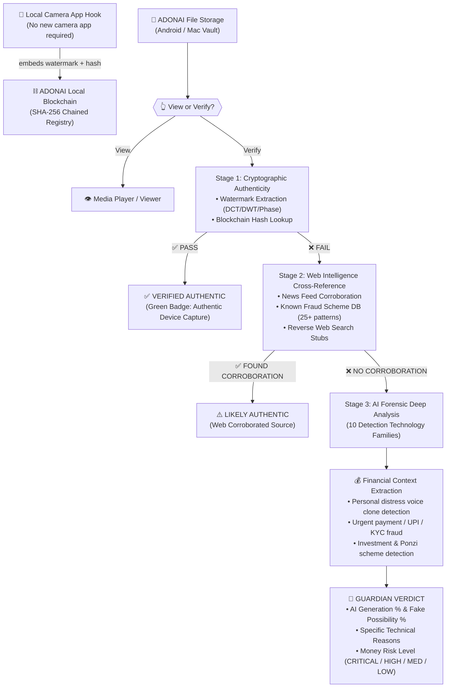

# ADONAI — Personal Cyber-Intelligence & Guardian Media Authenticity System

**See the exposure. Verify the truth. Act before damage spreads.**

ADONAI is an evidence-first personal cyber-intelligence system and **ADONAI Guardian** media authenticity brain. It combines an Android protection agent, local camera ContentObserver watermark hook, a 13-view Mac cyber dashboard, a local append-only blockchain registry, a 3-stage progressive verification pipeline, and an AI forensic engine covering 10 detection technology families to combat personal and general financial fraud.

---

## 🛡️ Core Philosophy: Truth-First Verification
> *"We don't search for what is fake; we verify what is true, and eliminate the fake."*

1. **Every edited, altered, or synthetic video, audio, or image is treated as unverified/suspect** until proven authentic.
2. **Local Camera Hook**: When you record or capture media using your existing smartphone camera app, ADONAI Guardian embeds a cryptographic, device-bound, frequency-domain watermark and registers its unique fingerprint on the local blockchain.
3. **Compression-Resistant**: The embedded watermark modifies mid-frequency DCT coefficients and audio phase bands, surviving JPEG compression, resizing, and sharing across chat applications.
4. **ADONAI File Storage Vault**: When media is received, users can tap **View** or **Verify**.

---

## 🔄 The 3-Stage Guardian Verification Pipeline



---

## 🔬 10 AI Content Detection Technology Families

| Family | Methodology | What It Does in ADONAI Guardian |
|---|---|---|
| **1. Statistical Forensics** | Perplexity ($PPL$), Burstiness, Stylometry | Measures predictable language structures, sentence length variances, and token distributions. |
| **2. Machine Learning** | Calibrated Feature Classifiers | Separates human speech and natural camera distributions from AI model outputs. |
| **3. Deep Learning** | CNN / ViT / Swin Transformers | Analyzes inter-patch relationships, edge artifacts, and texture inconsistencies. |
| **4. Frequency Domain** | FFT, 2D-DCT, Wavelets (DWT) | Identifies unnatural frequency distributions and AI upsampling fingerprints (F3Net/SPSL). |
| **5. Signal Processing** | STFT, Mel Spectrogram, MFCC, CQCC, LFCC | Detects vocoder artifacts, synthetic harmonics, and phase discontinuities (ASVspoof benchmark). |
| **6. Watermarking** | QIM Mid-Frequency DCT + Spread-Spectrum | Extracts active generation and device provenance signals. |
| **7. Digital Provenance** | Immutable Local Blockchain | Verifies cryptographically signed origin records and chronological block hashes. |
| **8. Anomaly Detection** | Distributional Deviation Analysis | Flags deviations from natural sensor noise, acoustic envelopes, and pixel correlation. |
| **9. Model Fingerprinting** | Generator Artifact Identification | Detects GAN checkerboard patterns, Diffusion reconstruction errors (AEROBLADE), and vocoder signatures. |
| **10. Ensemble Learning** | Multi-Modal Weighted Voting | Blends all individual family scores into a single calibrated verdict with full explanatory reasoning. |

---

## 💰 Crucial Financial Fraud Analysis
ADONAI Guardian specifically targets the two main classes of modern AI financial crime:

1. **Personal Circle Fraud**:
   - Voice clones impersonating friends or family in distress (*"I had an accident at the hospital, send money immediately"*).
   - Scans for urgency pressure tactics, emotional coercion, and immediate wire/UPI solicitations.
2. **General / Investment Fraud**:
   - Fabricated news, deepfake executive announcements, and fake government schemes.
   - Built-in database covering 25+ real-world fraud schemes (UPI QR fraud, KYC freeze threats, Ponzi / Multi-X return guarantees, fake lottery processing fees, predatory loan apps).

---

## 📁 Repository Structure
- `backend/`
  - `main.py` — FastAPI backend with pairing, telemetry, cyber range, and 7 new Guardian media endpoints.
  - `database.py` — 28-table SQLite persistence layer with full `REAL` vs `LAB` environment separation.
  - `guardian_watermark.py` — DCT mid-frequency QIM image watermarking, spread-spectrum audio phase watermarking, temporal video hash chaining, and SHA-256 fingerprinting.
  - `guardian_blockchain.py` — Thread-safe, SQLite-backed append-only blockchain registry with genesis validation and block integrity verification.
  - `guardian_detector.py` — Multi-modal forensic detection engine implementing all 10 technology families.
  - `guardian_web_intel.py` — Stage 2 cross-reference engine with 25+ offline financial fraud patterns and currency/urgency extraction.
  - `detection_engine.py` — 10-layer deterministic network and permission security detection engine.
  - `cyber_range.py` — 1,000-node simulated identity range controller and ground-truth evaluation harness.
- `dashboard/`
  - `index.html` — 13-view Mac web dashboard (View 13: 🛡️ Guardian Media Vault).
  - `static/js/dashboard.js` — Cyber range 3D canvas visualizer and Guardian interactive verification handler.
  - `mobile.html` — Interactive companion simulator.
- `android-agent/`
  - `guardian/GuardianWatermarkSDK.kt` — Device watermark embedding and backend registration engine.
  - `guardian/CameraObserverService.kt` — Foreground ContentObserver service monitoring camera capture.
  - `guardian/GuardianFileStorageActivity.kt` — Media vault UI with View/Verify dialogs and Jetpack Compose cards.
  - `guardian/VerificationResultScreen.kt` — Full 3-stage verdict breakdown, AI% gauges, and financial fraud warnings.
- `tests/`
  - `test_adonai_suite.py` — Automated 9-test verification suite covering both network defense and Guardian media pipelines.

---

## 🚀 How to Run the System

### 1. Launch the Mac Intelligence Backend & Lab Dashboard
```bash
# Starts FastAPI server on http://127.0.0.1:8410
./scripts/start_mac_lab.sh
```
- **Mac Dashboard & Guardian Vault**: Open `http://127.0.0.1:8410` (Navigate to **13 / Guardian Media Vault**)
- **Android Companion UI**: Open `http://127.0.0.1:8410/mobile`

### 2. Run Automated Tests & Evaluation Benchmark
```bash
./scripts/run_tests_and_benchmarks.sh
```
All 9 automated acceptance tests verify:
1. 28 required SQLite tables and 1,000 simulated endpoint identities
2. Device pairing and token revocation
3. Secret redaction privacy safeguards
4. Contextual scam guard (benign family vs OTP phishing vs compromised trust)
5. Deterministic replay and cross-endpoint correlation
6. Ground-truth evaluation benchmark (100% precision, 0% FPR)
7. Local LLM analyst explanation with deterministic fallback
8. **Guardian Stage 1**: Camera watermark embedding, extraction, and blockchain anchoring
9. **Guardian Stages 2 & 3**: Web intelligence scheme detection and 10-family AI forensic evaluation
